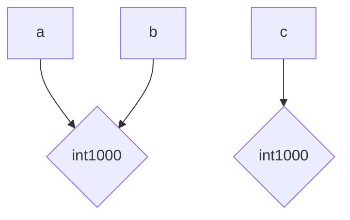

# Лабораторная работа № 1. Выполнение программы, объекты и базовые типы Python

## 1. Общая информация

**Темы курса:**

1. Python, CPython и модель выполнения программы.
2. Типы данных и объектная модель Python.

## 2. Цель работы

Разобраться, как CPython выполняет программу, научиться отличать имя от объекта, корректно применять операции сравнения и работать с базовыми типами данных Python.

## 3. Задачи работы

* Освоить запуск Python-кода в REPL и из файла, изучить путь программы от исходного кода до байткода.
* Разобраться в объектной модели Python: связывание имён с объектами, type(), id(), == и is.
* Изучить базовые типы данных (int, float, bool, complex, str, None), операции над ними и явные преобразования типов.
* Исследовать особенности чисел с плавающей точкой и правила их безопасного сравнения.
* Освоить работу со строками: индексацию, срезы, Unicode и форматирование.
* Разработать консольную программу — информационную карточку вычислительного эксперимента.

---

## 4. Ход работы

## Задание 1. От исходного кода к байткоду

### Часть 1. Режимы запуска

При запуске данного кода в REPL сразу вывело ответ, в то время как в файле `task_1.py` не вывело ничего.
   ```python
   2 + 3*4
   ```

В REPL изначально заложен определенный порядок действий, в который входит вывод результата, а для того чтобы этот результат выводился при запуске файла `task_1.py`, нужно ввести команду `print()`.

   ```python
   print(2 + 3*4)
   ```
### Часть 2. Выражения и инструкции
в файл `task_1.py` был добавлен следующий код:
   ```python
   course = "Python"
hours = 4 * 2
print(f"{course}: {hours} часов")
   ```

**Выражения**:
* `Python`(строковое выражение);
* `4 * 2` (арифметическое выражение);
* `course`,`hours`(строковые выражения);
* `f""`(f-строка);

**Инструкции:**
* `course = "Python"` , `hours = 4 * 2` (инструкция присваивания);
* `print(f"")` (инструкция вывода);

**Литералы:**
* `Python`; 
* `4` , `2`;
* `f""`;

**Имена, создающиеся при выполнении программы:**
* `course` , `hours` (переменные);

### Часть 3. AST и байткод

Версия: Python 3.14.7

В терминале были выполнены следующий команды:
   ```
    python --version
    python -m ast task_1.py
    python -m dis task_1.py
   ```

**Узлы, соответствующие присваиванию:**
*  Assign(
         targets=[
            Name(id='course', ctx=Store())],
         value=Constant(value='Python')),
* Assign(
         targets=[
            Name(id='hours', ctx=Store())],
         value=BinOp(
            left=Constant(value=4),
            op=Mult(),
            right=Constant(value=2))),

**Узел, соответствующий арифметической операции:**
* BinOp(
            left=Constant(value=4),
            op=Mult(),
            right=Constant(value=2))),

**Узел, соотвутствующий вызову `print()`:**
* Call(
            func=Name(id='print', ctx=Load()),
            args=[
               JoinedStr(
                  values=[
                     FormattedValue(
                        value=Name(id='course', ctx=Load()),
                        conversion=-1),
                     Constant(value=': '),
                     FormattedValue(
                        value=Name(id='hours', ctx=Load()),
                        conversion=-1),
                     Constant(value=' часов')]


**инструкции, отвечающие за загрузку константы:**
* LOAD_SMALL_INT          14
* LOAD_CONST               1 ('Python')
* LOAD_SMALL_INT           8
* LOAD_CONST               2 (': ')
* LOAD_CONST               3 (' часов')
* LOAD_CONST               4 (None)

**инструкции, отвечающие за вызов функции:**
* CALL 1


### Контрольный вопрос

**Почему байткод CPython нельзя считать машинным кодом процессора?**
* Машинный код состоит из инструкций, понятных конкретному процессору и привязан к операционной системе. 
* Байт-код является абстракцией: он универсален и исполняется только внутри специальной программной оболочки - CPython.

---


## Задание 2. Имена, объекты и сравнение

В файле `task_2.py` сделали следующий код:
```python
a = 1000
b = a
c = int("1000")

print("Типы:", type(a), type(b), type(c))
print("Идентификаторы:", id(a), id(b), id(c))
print("a == b:", a == b)
print("a is b:", a is b)
print("a == c:", a == c)
print("a is c:", a is c)
```

**Прогнозы четырех сравнений:**

| Сравнение | Прогноз |
|---|---|
| `a == b` | `True` |
| `a is b` | `True` |
| `a == c` | `True` |
| `a is c` | `False` |

**1. связи между именами и объектами:**

2. равенство(`==`) проверяет совпдают ли значения переменных, в то время как идентичность(`is`) проверяет являются ли переменные одним и тем же объектом в памяти.
3. заменим значение `c` на None и добавим корректную проверку того, что c обозначает объект `None`.
    ```python
    c = None
    print("c is None", c is None)
    ```
4.  выполним отдельно следующий фрагмент:


   ```python
   first = "python"
   second = "py" + "thon"

   print(first == second)
   print(first is second)
   ```
   
После выполнения программы в обоих сравнениях вывело `True`. В первом случае вывело `True`, потому что значение строк одинаково. Во-втором случае вывело `True`, потому что компилятор CPython складывает строки "py" + "thon" заранее и заменяет на строку python, поэтому переменые `first` и `second` занимают место одного и того же объекта в памяти. 

5. сформулируем правило: когда применять `==`, а когда - `is`.
* `==` - нужно применять, когда необходимо сравнить значения переменных;
* `is` - нужно применять, когда необходимо проверить являются ли переменные одним и тем же объектом в памяяти;
### Контрольные вопросы

1. Создает ли инструкция b = a копию объекта?
Нет, она копирует сслыку на этот объект.
2. Что возвращают `type()` и `id()`? 
* `type()` - возвращает класс объекта;
* `id()` - возвращает id(уникальный идентификатор) объекта; 

3. Почему `None` принято сравнивать с помощью `is`, а числа и строки - с помощью `==`? - None это единственный объект в памяти, поэтому сравнивать с помощью `is` надежнее. Числа и строки - это значения, которые могут занимать разные объекты в памяти, поэтому они сравниются с помощью `==`.
---

## Задание 3. Числовые типы, операции и преобразования


### Эксперимент A. `int` и арифметические операторы

Для значений `x = 17` и `y = 5` выведем следующие результаты и типы результатов операции:

```
x + y =  22 <class 'int'>
x - y =  12 <class 'int'>
x * y =  85 <class 'int'>
x / y =  3.4 <class 'float'>
x // y =  3 <class 'int'>
x % y =  2 <class 'int'>
x ** y =  1419857 <class 'int'>
```


`/` - это обычное деление, которое выводит как целые числа(`int`), так и вещественные(`float`), а `//` - это целоцисленное деление, оно округляет значение деления до целого числа(`int`).
### Эксперимент B. Большие целые числа
Вычесленное выражение:
```
2**1000 = 1071508607186267320948425049060001810561404
81170553360744375038837035105112493612249319837881569585812759467291755314682518714528569231404
359845775746985748039345677748242309854210746050623
71141877954182153046474983581941267398767559165543946077062914571196477686542167660429831652624386837205668069376
```

Результат - число, состоящее из 302 цифр. В других языках, в отличие от python, ограничена длина чисел и при выходе из  этой разрядности происходит переполнение.

### Эксперимент C. `float`
Исследуем выражение:
```python
result = 0.1 + 0.2
```
```
result = 0.30000000000000004
result = 0.3 : False
result - 0.3 = 5.551115123125783e-17
math.isclose(result, 0.3) =  True
```
Причина полученных результатов: числа с плавающей точкой хранятся в двоичной системе, поэтому числа 0.1, 0.2 и т.д невозможно представить точно, вследствие чего появляются погрешности. Сравнивать такие числа необходимо с помощью `math.isclose()`.

### Эксперимент D. `bool`, `complex` и явное преобразование типов

В данной таблице представлены результаты выражений и их типы:

| Выражение | Результат | Тип |
|---|---|---|
| `int("42")` | `42` | `int` |
| `float("3.14")` | `3.14` | `float` |
| `str(2026)` | `2026` | ` str` |
| `bool(0)` | `False` | `bool` |
| `bool(-1)` | `True` | ` bool` |
| `bool("")` | `False` | `bool` |
| `bool("False")` | `True` | `bool` |
| `complex(2, -3)` | `(2-3j)` | `complex` |

Фунция `bool()` выводит `False`, только при пустой(нулевой) строке, поэтому в нашем случае вывело `True`.

Также выведем действительную и мнимую части числа `(2 - 3j)`:

```
int('42')      =  42    <class 'int'>
float('3.14')  =  3.14    <class 'float'>
str(2026)      =  2026    <class 'str'>

bool(0)        =  False    <class 'bool'>
bool(-1)       =  True    <class 'bool'>
bool()         =  False    <class 'bool'>
bool('False')  =  True    <class 'bool'>

complex(2, -3) =  (2-3j)    <class 'complex'>
Действительная часть: 2.0
мнимая часть: -3.0
```

### Контрольные вопросы

Почему результат обычного деления двух объектов `int` имеет тип `float`? - `/` это операция, которая всегда возвращает точный результат деления, который не является целым числом.

В чем отличие преобразования `int("42")` от `int(42.9)`? 

`int("42")` - преобразует строку в целое число.
`int(42.9)` - отбрасывает вещественную часть, получится `42`.

Какие значения из эксперимента D являются `falsy`? - это значения, которые при преобразовании в `bool` дают `False`.

* `bool(0)`;
* `bool("")`;

---

## Задание 4. Строки, Unicode и форматирование
**Исходные данные для файла `task_4.py`:**
```python
student = "Анна Смирнова"
course = "Основы программирования на Python"
completed = 7
total = 10
```

**Выполним задания 1-8:**
```python
#1
print(student[0], student[3])
#2
print(student[:4])
print(student[5:])
#3
print(student.upper())
print(student.lower())
#4
print(student[0] + "." + student[5] + ".")
#5
print(course[::-1])
#6
print("%s — %s: %d/%d (70.0%%) " % (student, course, completed, total))
print("{} — {}: {}/{} (70.0%) " .format(student, course, completed, total))
print(f"{student} — {course}: {completed}/{total} (70.0%)")
#7
symbol = "Я"
print(symbol)
print(ord(symbol))
print(chr(ord(symbol)))
print(symbol.encode("utf-8"))
print(len(symbol))
print(len(symbol.encode("utf-8")))
#8
#symbol[0] = "А"
```

**ошибка, показывающаяся при выполнении кода в пункте 8:**
```python
   Traceback (most recent call last):
  File "/home/rost/pycharmlab/topit_fundamentals_of_programming/lab_01/task_4.py", line 30, in <module>
    symbol[0] = "А"
    ~~~~~~^^^
TypeError: 'str' object does not support item assignment
```

Причина ошибки - в python строки являются неизменяемыми объектами, поэтому нельзя поменять отдельный символ по индексу.

### Контрольные вопросы
1. Почему `len(symbol)` и `len(symbol.encode("utf-8"))` могут различаться? - Функция `len(symbol)` счиатет кол-во символов, а функция `len(symbol.encode("utf-8"))` считает количество байтов в этой кодировке, поэтому значения могут различаться.
2. Что означают границы и шаг в записи `text[start:stop:step]`? - `start`, это индекс символа, с которого начинается срез строки, `stop` - индекс символа, перед которым срез заканчивается  
3. Почему строка считается неизменяемым объектом, хотя методы вроде `.upper()` возвращают измененный текст? - эти методы возвращают изменненый текст, но они не меняют саму строку, а создают новую.


---

## Задание 5. Информационная карточка вычислительного эксперимента

#### Описание программы
Программа запрашивает у пользователя данные об эксперименте,
затем выводит информационную карточку и диагностическую строку
с типами введённых значений.

#### Пример работы

```
Имя исследователя: Анна Смирнова
Название эксперимента: Проверка модели
Количество выполненных запусков: 10
Длительность одного запуска, с: 60
Действительная часть коэффициента: 2
Мнимая часть коэффициента: -3
========================================
ЭКСПЕРИМЕНТ: Проверка модели
Исследователь: Анна Смирнова
Запуски: 10
Общее время: 600.00 с (10.00 мин)
Коэффициент: (2-3j)
Квадрат модуля: 13.00
Есть выполненные запуски: True
========================================
Типы введённых значений:
  name = <class 'str'>
  experiment = <class 'str'>
  runs       = <class 'int'>
  duration   = <class 'float'>
  real       = <class 'float'>
  imag       = <class 'float'>
========================================
```

#### Анализ программы
Для каждого имени из программы укажем, с объектом какого типа оно связано после выполнения соответствующей инструкции:

| Имя | Тип |
|---|---|
| `researcher` | `str` |
| `experiment` | `str` |
| `runs` | `int` |
| `duration` | `float` |
| `real` | `float` |
| `imag` | `float` |
| `total_seconds` | `float` |
| `total_minutes` | `float` |
| `coefficient` | `complex` |
| `modulus_squared` | `float` |
| `has_runs` | `bool` |


**разберем арифметическую строку**
```
total_minutes = total_seconds / 60
```

* Литерал - `60`;
* Имена - `total_minutes`, `total_seconds `;
* Операторы - `=`, `/`;
* вызовы функция - отсутствуют;

**Опишем исходный путь программы**

task_5.py  →  разбор  →  AST  →  байткод  →  выполнение
 
почему результат `input()` необходимо явно преобразовывать перед арифметическими вычислениями? - Функция `input()` всегда возвращает строку (str), даже если пользователь ввёл число. Поэтому строку нужно явно преобразовать в `int` или `float`.

### Контрольный вопрос

Что в этой программе изменится на уровне объектов и связывания имен после повторного присваивания нового значения уже существующему имени?

При повторном присваивании нового значения уже существующему имени создаётся новый объект, а имя перепривязывается к нему. Если к старому объетку больше не остаётся ссылок, то он со временем удаляется сборщиком мусора.

---

## 5. Вывод 

В ходе работы изучены выполнение программ в CPython, объектная модель Python и базовые типы данных. Освоены запуск кода, связывание имён с объектами, операции == и is, числовые типы и преобразования, погрешность float, работа со строками и Unicode. Разработана консольная программа — карточка эксперимента.

Три наиболее неожиданные особенности Python:

* Целые числа произвольной длины — нет переполнения, как в других языках.
* `0.1 + 0.2 != 0.3` — погрешность чисел с плавающей точкой, нужен `math.isclose()`.
* Непустая строка всегда истинна: `bool("False") → True`, потому что `bool()` проверяет наличие символов, а не их смысл.

